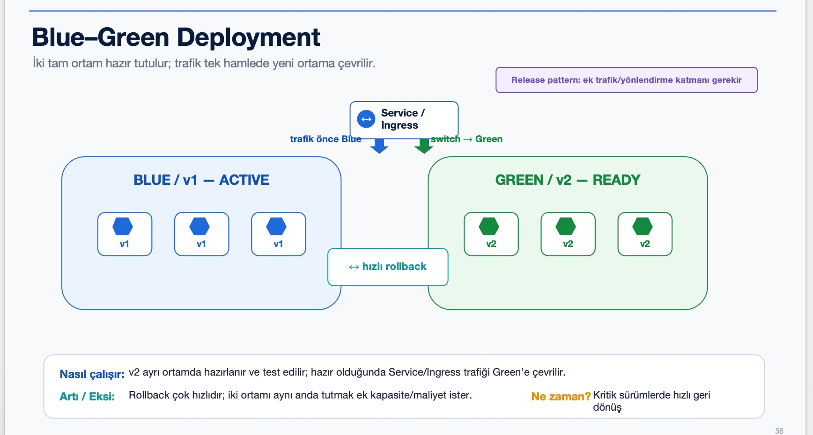
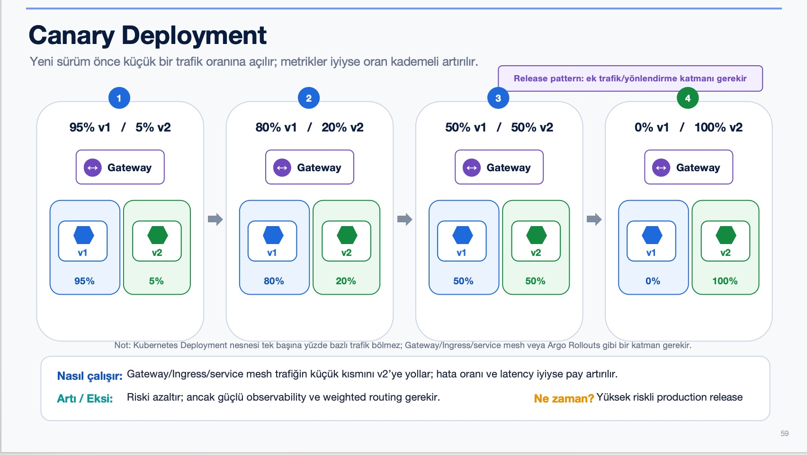

# Blue-Green ve Canary Dağıtım Stratejileri

> **Seviye:** Advanced
> **Tahmini süre:** 75–100 dakika
> **Lab Kapsamı:** İsteğe bağlı

## Amaç

Bu labda iki uygulama sürümünü aynı anda çalıştıracak, Service selector ile Blue-Green geçişi yapacak ve Pod oranlarını değiştirerek Canary yayınını kademeli biçimde ilerleteceksiniz. İsteğe bağlı bölümde Gateway API ile ağırlıklı trafik dağıtımını uygulayacaksınız.

## Çalışma dizini

```bash
cd ~/k8s-labs/advanced/lab-03-blue-green-and-canary
```

## 1. Uygulama sürümlerini ve test istemcisini hazırla

```bash
export IMAGE="devops-app"

docker build -t "${IMAGE}:1.0" ~/k8s-labs/app/devops-app
docker build --build-arg APP_VERSION=2.0 -t "${IMAGE}:2.0" ~/k8s-labs/app/devops-app
kind load docker-image "${IMAGE}:1.0" "${IMAGE}:2.0" --name k8s-labs

kubectl create namespace private-app --dry-run=client -o yaml | kubectl apply -f -
kubectl run test-client -n private-app \
  --image=curlimages/curl:8.12.1 --restart=Never -- sleep 3600
kubectl wait -n private-app --for=condition=Ready pod/test-client --timeout=90s
```

## 2. Blue-Green dağıtımını başlat



[Blue-Green Mermaid akışını aç](diagrams/blue-green.md)

Manifest aynı anda iki Deployment oluşturur:

- Blue: `1.0`, iki Pod
- Green: `2.0`, iki Pod
- `strategy-app` Service: başlangıçta `version=blue` seçer

```bash
sed "s|__IMAGE__|${IMAGE}|g" starter/blue-green.yaml | kubectl apply -f -
kubectl rollout status deployment/devops-app-blue -n private-app --timeout=120s
kubectl rollout status deployment/devops-app-green -n private-app --timeout=120s
kubectl get pods -n private-app -l app=strategy-app -L version
```

Canlı Service selector'ını ve endpoint'leri inceleyin:

```bash
kubectl get service strategy-app -n private-app -o jsonpath='{.spec.selector}{"\n"}'
kubectl get endpointslice -n private-app -l kubernetes.io/service-name=strategy-app
```

Trafiğin Blue sürümüne gittiğini doğrulayın:

```bash
kubectl exec -n private-app test-client -- curl -s http://strategy-app/
```

Beklenen sonuçta `"version":"1.0"` ve Blue Pod adı görünür.

## 3. Trafiği Green sürümüne geçir

```bash
kubectl patch service strategy-app -n private-app \
  -p '{"spec":{"selector":{"app":"strategy-app","version":"green"}}}'
kubectl exec -n private-app test-client -- curl -s http://strategy-app/
kubectl get service strategy-app -n private-app -o jsonpath='{.spec.selector}{"\n"}'
```

Beklenen sonuçta `"version":"2.0"` ve Green Pod adı görünür. Deployment'lar yeniden başlatılmadan yalnızca Service hedefi değişmiştir.

## 4. Blue sürümüne rollback yap

```bash
kubectl patch service strategy-app -n private-app \
  -p '{"spec":{"selector":{"app":"strategy-app","version":"blue"}}}'
kubectl exec -n private-app test-client -- curl -s http://strategy-app/
```

Yanıt tekrar `1.0` olur. Blue-Green kaynaklarını temizleyin:

```bash
kubectl delete deployment devops-app-blue devops-app-green -n private-app
kubectl delete service strategy-app -n private-app
```

## 5. Pod oranıyla Canary yayınını başlat



[Canary Mermaid akışını aç](diagrams/canary.md)

Bu yöntem ek bir trafik controller'ı gerektirmez. Aynı Service'in arkasında 9 adet v1 ve 1 adet v2 Pod çalışır.

```bash
sed "s|__IMAGE__|${IMAGE}|g" starter/canary-service.yaml | kubectl apply -f -
kubectl rollout status deployment/devops-app-canary-v1 -n private-app --timeout=180s
kubectl rollout status deployment/devops-app-canary-v2 -n private-app --timeout=180s
kubectl get pods -n private-app -l app=devops-app-canary -L version
```

Yirmi istek göndererek dağılımı gözlemleyin:

```bash
for i in $(seq 1 20); do
  kubectl exec -n private-app test-client -- curl -s http://strategy-canary/ \
    | grep -o '"version":"[^"]*"'
done
```

Sonuç yaklaşık %90 `1.0`, %10 `2.0` olur. Az sayıda istekte tam oran garanti edilmez.

## 6. Canary oranını %50/%50 yap

```bash
kubectl scale deployment/devops-app-canary-v1 -n private-app --replicas=5
kubectl scale deployment/devops-app-canary-v2 -n private-app --replicas=5
kubectl rollout status deployment/devops-app-canary-v1 -n private-app --timeout=180s
kubectl rollout status deployment/devops-app-canary-v2 -n private-app --timeout=180s
kubectl get pods -n private-app -l app=devops-app-canary -L version
```

Tekrar yirmi istek gönderin ve dağılımı karşılaştırın:

```bash
for i in $(seq 1 20); do
  kubectl exec -n private-app test-client -- curl -s http://strategy-canary/ \
    | grep -o '"version":"[^"]*"'
done
```

## 7. Yeni sürümü tamamen canlıya al

```bash
kubectl scale deployment/devops-app-canary-v2 -n private-app --replicas=10
kubectl scale deployment/devops-app-canary-v1 -n private-app --replicas=0
kubectl rollout status deployment/devops-app-canary-v2 -n private-app --timeout=180s
kubectl get pods -n private-app -l app=devops-app-canary -L version
```

Son testte bütün yanıtlar `2.0` olmalıdır:

```bash
for i in $(seq 1 10); do
  kubectl exec -n private-app test-client -- curl -s http://strategy-canary/ \
    | grep -o '"version":"[^"]*"'
done
```

Pod oranlı Canary kaynaklarını temizleyin:

```bash
kubectl delete deployment devops-app-canary-v1 devops-app-canary-v2 -n private-app
kubectl delete service strategy-canary -n private-app
```

## 8. İsteğe bağlı: Gateway API ile ağırlıklı Canary

> Bu bölüm için Advanced Lab 1 tamamlanmış ve Traefik `30088` portunda veya cutover yapıldıysa ana ingress portunda çalışıyor olmalıdır.

Gateway API kuralında ortamınıza tanımlı alan adınızı (`studentX-app1.devopsatolyesi.com`) kullanarak ağırlıklı canary testi yapabilirsiniz:

```bash
export STUDENT_ID="${STUDENT_ID:-$(hostname)}"
export APP_HOST="${STUDENT_ID}-app1.devopsatolyesi.com"
echo "Canary test hostu: ${APP_HOST}"

sed "s|__IMAGE__|${IMAGE}|g; s|__APP_HOST__|${APP_HOST}|g" \
  starter/canary-httproute.yaml | kubectl apply -f -
kubectl rollout status deployment/strategy-app-v1 -n private-app --timeout=120s
kubectl rollout status deployment/strategy-app-v2 -n private-app --timeout=120s
kubectl get gateway,httproute -n private-app
```

Trafiği tanımlanan alan adı üzerinden (%90 v1 / %10 v2 ağırlığıyla) test edin:

```bash
# 1. Yöntem: Gateway API Cutover yapıldıysa doğrudan alan adı (HTTPS):
for i in $(seq 1 20); do
  curl -k -s "https://${APP_HOST}/" | grep -o '"version":"[^"]*"'
done

# 2. Yöntem: Traefik preview portu (NodePort 30088) üzerinden:
for i in $(seq 1 20); do
  curl -s -H "Host: ${APP_HOST}" http://127.0.0.1:30088/ | grep -o '"version":"[^"]*"'
done
```

Beklenen sonuç: 20 isteğin yaklaşık %90'ı (`v1`), yaklaşık %10'u (`v2`) olarak döner.

Ağırlıkları %50 / %50 olarak güncelleyin:

```bash
kubectl patch httproute devops-app-canary -n private-app --type=json \
  -p '[{"op":"replace","path":"/spec/rules/0/backendRefs/0/weight","value":50},{"op":"replace","path":"/spec/rules/0/backendRefs/1/weight","value":50}]'
```

DNS üzerinden testi tekrarlayın ve dağılımın dengelendiğini (yaklaşık 10 `v1`, 10 `v2`) gözlemleyin:

```bash
for i in $(seq 1 20); do
  curl -k -s "https://${APP_HOST}/" | grep -o '"version":"[^"]*"'
done
```

## Başarı kriterleri

- Blue ve Green sürümlerinin aynı anda çalıştığını doğruladınız.
- Service selector ile kesintisiz geçiş ve rollback yaptınız.
- Pod sayılarını değiştirerek Canary oranını ilerlettiniz.
- Service tabanlı Canary ile Gateway ağırlıklı Canary arasındaki farkı açıklayabiliyorsunuz.

## Temizlik

```bash
kubectl delete namespace private-app
```
