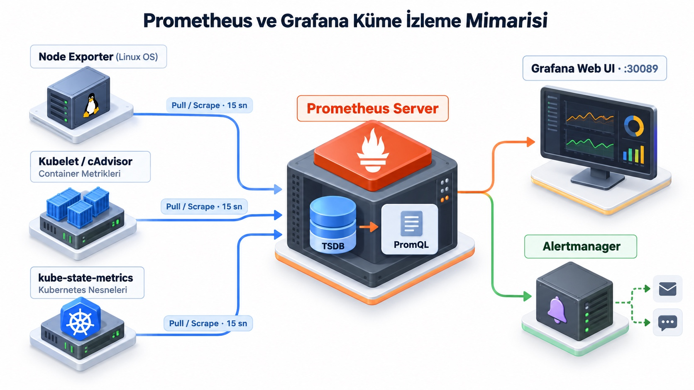

# * Prometheus ve Grafana ile Küme ve Sistem Metriklerini İzle

> **Seviye:** Advanced
> **Tahmini süre:** 90–120 dakika
> **Eğitim durumu:** İsteğe bağlı

## Amaç

- Helm ile `kube-prometheus-stack` (Prometheus, Grafana, Node Exporter, Kube-State-Metrics) paketini kurmak.
- Nginx Edge Proxy ve NodePort port eşlemelerini çakışma olmadan doğru uçlara bağlamak.
- Linux host ve Kubernetes node'larının kaynak kullanımını (CPU, RAM, Disk, Ağ) Node Exporter ile izlemek.
- Kümedeki tüm container ve Pod'ların kaynak tüketimini Kubelet ve cAdvisor üzerinden otomatik toplamak.
- Prometheus web arayüzünde otomatik hedefleri incelemek ve PromQL sorguları çalıştırmak.
- Grafana arayüzünde sıfırdan özel panel oluşturma, değişken (variable) filtresi ekleme ve alert kuralları tanımlama pratiklerini öğrenmek.

## Kullanılan Kubernetes nesneleri

- **Helm Release:** Prometheus, Grafana, Alertmanager ve exporter bileşenlerini tek merkezden kurar ve yönetir.
- **DaemonSet:** `node-exporter` pod'larını her node'a dağıtarak alt donanım ve Linux çekirdeği metriklerini toplar.
- **ServiceMonitor:** Prometheus Operator'a hangi Service uçlarından metrik toplanacağını bildirir.
- **PrometheusRule:** PromQL ifadeleriyle eşik değer aşıldığında üretilecek alert koşullarını tanımlar.
- **ConfigMap:** Grafana dashboard JSON tanımlarını taşır (`grafana_dashboard: "1"`).
- **Secret:** Grafana yönetici giriş bilgilerini (`admin-user`, `admin-password`) saklar.

## Çalışma dizini

```bash
cd ~/k8s-labs/advanced/lab-05-prometheus-grafana
```

## Erişim ve Ağ Mimarisi

[](images/monitoring-architecture.jpg)
*(Görseli tam boyutta büyütmek için üzerine tıklayabilirsiniz)*

İzleme araçlarına iki farklı yöntemle erişilebilir. Her iki yöntem de port çakışması yaşanmayacak şekilde ayrılmıştır:

| Servis | Erişim Türü | Adres / Port | Açıklama |
| --- | --- | --- | --- |
| **Grafana** | NodePort (Doğrudan) | `http://SUNUCU_IP:30089` | Kind cluster `hostPort: 30089` portudur |
| **Grafana** | Nginx Edge Proxy (HTTPS) | `https://KULLANICI-grafana.ALAN_ADI` | Host üzerindeki `127.0.0.1:13000` portuna yönlenir |
| **Prometheus** | Nginx Edge Proxy (HTTPS) | `https://KULLANICI-prometheus.ALAN_ADI` | Host üzerindeki `127.0.0.1:19090` portuna yönlenir |
| **Prometheus** | Port-Forward (Yerel) | `http://127.0.0.1:9090` | Doğrudan geliştirici tünelidir |

- **Varsayılan Kullanıcı adı:** `admin`
- **Varsayılan Parola:** `devops-monitor-2026`

## 1. İzleme Namespace'i ve Grafana Giriş Secret'ını Oluştur

Grafana yönetici giriş bilgileri `starter/grafana-admin-secret.yaml` manifestinde tanımlanmıştır:

```yaml
apiVersion: v1
kind: Secret
metadata:
  name: grafana-admin
  namespace: monitoring
type: Opaque
stringData:
  admin-user: "admin"
  admin-password: "devops-monitor-2026"
```

Namespace'i ve yönetici Secret'ını uygula:

```bash
kubectl create namespace monitoring --dry-run=client -o yaml | kubectl apply -f -
kubectl apply -f starter/grafana-admin-secret.yaml
kubectl -n monitoring get secret grafana-admin
```

Beklenen sonuç: `grafana-admin` Secret'ı `monitoring` namespace'inde listelenir.

---

## 2. Prometheus Community Helm Deposunu Ekle ve Güncelle

```bash
helm repo add prometheus-community https://prometheus-community.github.io/helm-charts
helm repo update
```

---

## 3. Kube Prometheus Stack'i Kur

Kurulum ayarları `starter/monitoring-values.yaml` dosyasındadır:
- Grafana `30089` NodePort portunda açılır.
- Hazır dashboard'lar aktiftir (`defaultDashboardsEnabled: true`).
- Kind kümesinde localhost dinleyen iç bileşenler (kubeControllerManager, kubeScheduler, kubeEtcd, kubeProxy) hedeflerden çıkarılarak listenin temiz kalması sağlanır.

Kurulumu başlat:

```bash
helm upgrade --install monitoring prometheus-community/kube-prometheus-stack \
  --version 91.5.0 \
  --namespace monitoring \
  --values starter/monitoring-values.yaml \
  --wait --timeout=300s
```

Kurulan bileşenleri doğrula:

```bash
kubectl -n monitoring get pods,svc
```

Beklenen sonuç: Prometheus, Alertmanager, Grafana, Kube-State-Metrics ve 3 node'un tamamında çalışan Node Exporter Pod'ları `Running` durumuna gelir.

---

## 4. Nginx Edge Proxy ve Doğrudan Erişim Portlarını Bağla

Nginx Edge Proxy kayıtlarının (`13000` ve `19090`) arka plandaki pod'lara ulaşabilmesi ve tarayıcıdan HTTPS ile açılabilmesi için port yönlendirmelerini arka planda başlat:

```bash
# Nginx Grafana slotu (13000 -> Grafana Service)
kubectl -n monitoring port-forward --address 127.0.0.1 svc/monitoring-grafana 13000:80 >/dev/null 2>&1 &
export GRAFANA_PORT_FORWARD_PID=$!

# Nginx Prometheus slotu (19090 -> Prometheus Service)
kubectl -n monitoring port-forward --address 127.0.0.1 svc/monitoring-kube-prometheus-prometheus 19090:9090 >/dev/null 2>&1 &
export PROMETHEUS_PORT_FORWARD_PID=$!
```

Bağlantıların aktif olduğunu yerel `curl` ile kontrol et:

```bash
curl -I http://127.0.0.1:13000
curl -I http://127.0.0.1:19090
```

Beklenen sonuç: Her iki porttan da HTTP yanıtı (200 veya 302 yönlendirmesi) alınır. Artık hem `https://KULLANICI-grafana.ALAN_ADI` hem de doğrudan `http://SUNUCU_IP:30089` üzerinden erişilebilir.

---

## 5. Prometheus UI Üzerinde Otomatik Toplanan Verileri ve Hedefleri İncele

Tarayıcında Prometheus arayüzünü aç (`https://KULLANICI-prometheus.ALAN_ADI` veya `http://127.0.0.1:19090`).

### A. Otomatik Keşfedilen Hedefleri (Targets) İnceleme
1. Üst menüden **Status -> Targets** sekmesine tıkla.
2. Prometheus'un kümede önceden hiçbir ayar yapmadan topladığı 4 ana grubu incele:
   - **`node-exporter`:** Ubuntu host ve Kind node'larının çekirdek ve donanım metrikleri (CPU, RAM, disk I/O, ağ).
   - **`kubelet / cAdvisor`:** Kümedeki tüm namespace'lerde çalışan Pod ve konteynerlerin bellek ve işlemci tüketimleri.
   - **`kube-state-metrics`:** Deployment, Pod, PVC gibi Kubernetes kaynaklarının durumları.
   - **`apiserver`:** Kubernetes API sunucusunun istek sıklığı ve gecikme metrikleri.
3. Tüm hedeflerin durumunun mavi/yeşil `UP (1/1)` olduğunu doğrula.

### B. Graph Sekmesinde PromQL Sorguları Çalıştırma
Üst menüden **Graph** sekmesine tıkla ve arama çubuğuna şu sorguları yazarak **Execute** butonuna bas:

1. **Host ve Node Boşta CPU Oranı:**
   ```promql
   node_cpu_seconds_total{mode="idle"}
   ```
   *Table* sekmesinden anlık değerleri, *Graph* sekmesine geçerek zaman içerisindeki çizgi grafiğini incele.

2. **Kullanılabilir Bellek Miktarı (MB Cinsinden):**
   ```promql
   node_memory_MemAvailable_bytes / 1024 / 1024
   ```

3. **Çalışan Pod Sayısı:**
   ```promql
   sum(kube_pod_status_phase{phase="Running"})
   ```

---

## 6. Grafana Paneline Giriş ve Hazır Panelleri İnceleme

Tarayıcında Grafana'yı aç (`https://KULLANICI-grafana.ALAN_ADI` veya `http://SUNUCU_IP:30089`).
- **Kullanıcı adı:** `admin`
- **Parola:** `devops-monitor-2026`

Sol menüden **Dashboards** sekmesine gir. Kurulumla birlikte gelen hazır panelleri incele:
- **Kubernetes / Compute Resources / Cluster:** Kümenin toplam CPU, bellek kapasitesi ve kullanım oranları.
- **Kubernetes / Compute Resources / Node (Pods):** Her bir node'un üzerindeki pod yükü ve kaynak dökümü.
- **Kubernetes / Compute Resources / Namespace (Pods):** `kube-system` ve `monitoring` servislerinin kaynak tüketimleri.
- **Node Exporter / Nodes:** Linux çekirdeği seviyesinde RAM dağılımı (buffers/cached) ve disk okuma-yazma hızları.

---

## 7. Grafana UI Üzerinde Sıfırdan Yeni Pano (Panel) Oluşturma

Grafana arayüzünde kendi görsel panelini adım adım tasarla:

1. Sol menüden **Dashboards** sekmesine tıkla, sağ üstteki **New -> New Dashboard** butonuna bas.
2. Açılan ekranda **+ Add visualization** butonuna tıkla.
3. Veri kaynağı listesinden **Prometheus** seç.
4. **Query (A)** alanına namespace bazlı bellek kullanımını veren şu PromQL ifadesini yapıştır:
   ```promql
   sum by (namespace) (container_memory_working_set_bytes) / 1024 / 1024
   ```
5. Sağ taraftaki ayar sütunundan:
   - **Panel options -> Title:** `Namespace Bellek Tüketimi (MB)` yaz.
   - En üstteki grafik türü açılır kutusundan **Bar gauge** seç.
   - **Standard options -> Unit:** `Data -> Megabytes (MB)` olarak ayarla.
   - **Thresholds:** `50` değerine sarı, `100` değerine kırmızı renk ata.
6. Sağ üst köşedeki mavi **Apply** butonuna bas.
7. Sayfanın sağ üstündeki disket simgesine (**Save dashboard**) tıkla, başlık olarak `Ozel Sistem Panosu` yaz ve kaydet.

---

## 8. Dashboard'a Dinamik Filtre (Variable) Ekleme

Farklı namespace'leri tek tıkla filtreleyebilmek için panoya bir değişken ekle:

1. Az önce oluşturduğun dashboard'un sağ üst köşesindeki çark simgesine (**Dashboard settings**) tıkla.
2. Sol menüden **Variables** sekmesini seç ve **Add variable** butonuna bas.
3. Alanları şu şekilde doldur:
   - **Name:** `secili_namespace`
   - **Type:** `Query`
   - **Query:** `label_values(container_memory_working_set_bytes, namespace)`
4. Sayfanın altındaki **Apply** butonuna bas ve sol üstteki ok simgesiyle panoya geri dön.
5. Pano üzerinde bir açılır kutu (dropdown) belirdiğini gör.
6. Az önce oluşturduğun panelin sağ üstündeki üç noktaya tıkla ve **Edit** seç.
7. Sorguyu seçilen değişkene göre filtreleyecek şekilde güncelle:
   ```promql
   sum(container_memory_working_set_bytes{namespace="$secili_namespace"}) / 1024 / 1024
   ```
8. **Apply** diyerek kaydet. Artık açılır kutudan hangi namespace seçilirse panel sadece o namespace'in verisini filtreler.

---

## 9. GitOps Yaklaşımıyla Hazır Pano ve Alarm Kurallarını Uygula

Panel ve alarm tanımlarını arayüz dışında YAML manifesti olarak yönetmek Kubernetes izleme standartlarındandır:

1. **`starter/cluster-alerts.yaml`:** Pod'lar sürekli yeniden başladığında veya bir node'un belleği %85'i aştığında alarm üreten `PrometheusRule` nesnesidir.
2. **`starter/cluster-dashboard.yaml`:** Grafana sidecar'ının otomatik tanıması için `grafana_dashboard: "1"` etiketine sahip hazır bir `ConfigMap` panosudur.

Manifestleri uygula:

```bash
kubectl apply -f starter/cluster-alerts.yaml
kubectl apply -f starter/cluster-dashboard.yaml
```

Kuralların ve panonun yüklendiğini kontrol et:

```bash
kubectl -n monitoring get prometheusrule cluster-workload-alerts
kubectl -n monitoring get configmap cluster-summary-dashboard -l grafana_dashboard=1
```

Grafana'da **Dashboards** sayfasına dönüldüğünde **Küme ve Sistem Özeti** panosunun otomatik yüklendiğini gör.

---

## 10. Canlı Yük Oluştur ve Grafana'da Değişimi İzle

İzlemenin canlı çalıştığını görmek için `default` namespace'inde tek satırlık bir CPU yük pod'u çalıştır:

```bash
kubectl run cpu-stress-test --image=busybox:1.36 --restart=Never -- sh -c "while true; do :; done"
kubectl get pod cpu-stress-test
```

Grafana paneline dön:
- **Dashboards -> Kubernetes / Compute Resources / Pod** paneline git.
- Namespace kutusundan `default`, Pod kutusundan `cpu-stress-test` seç.
- Sağ üstten zaman aralığını `Last 5 minutes` ve yenileme sıklığını `5s` yap.
- CPU kullanım grafiğinin tırmandığını canlı olarak izle.

Test tamamlandığında yük pod'unu sil:

```bash
kubectl delete pod cpu-stress-test
```

Beklenen sonuç: Pod silindikten sonra CPU grafiğinin tekrar taban seviyeye indiği doğrulanır.

---

## Doğal Doğrulama ve Beklenen Sonuç

İzleme altyapısının tüm bileşenlerinin sağlıklı çalıştığını aşağıdaki komutlarla doğrula:

```bash
kubectl -n monitoring get pods -l app.kubernetes.io/name=prometheus
kubectl -n monitoring get pods -l app.kubernetes.io/name=grafana
kubectl -n monitoring get daemonset -l app.kubernetes.io/name=prometheus-node-exporter
```

| Bileşen | Beklenen Durum |
| --- | --- |
| Prometheus Sunucusu | 1/1 Running |
| Grafana Web Arayüzü | 1/1 Running (Port: 30089 ve Port: 13000) |
| Node Exporter | 3/3 Desired / Current (Tüm node'larda aktif) |
| Kube State Metrics | 1/1 Running |

> [!NOTE]
> Bu labın sonunda Prometheus ve Grafana kaldırılmaz; sonraki çalışmalarda küme durumunu takip etmek üzere aktif bırakılır.

## Başarı kriterleri

- Prometheus hedeflerini ve temel PromQL sorgularını doğruladınız.
- Grafana'da hazır ve özel dashboard görüntülediniz.
- YAML ile dashboard ve alarm kuralı eklediniz.
- Canlı yükün metriklere yansıdığını gördünüz.

## İsteğe bağlı temizlik

İzleme sistemini kullanmaya devam edecekseniz bu adımı atlayın. Tamamen kaldırmak için:

```bash
kill "$GRAFANA_PORT_FORWARD_PID" "$PROMETHEUS_PORT_FORWARD_PID" 2>/dev/null || true
helm uninstall monitoring -n monitoring
kubectl delete namespace monitoring
```
