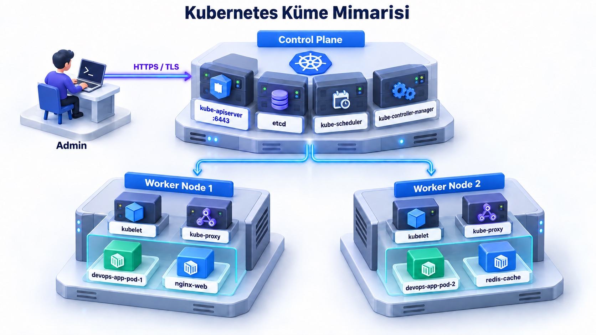
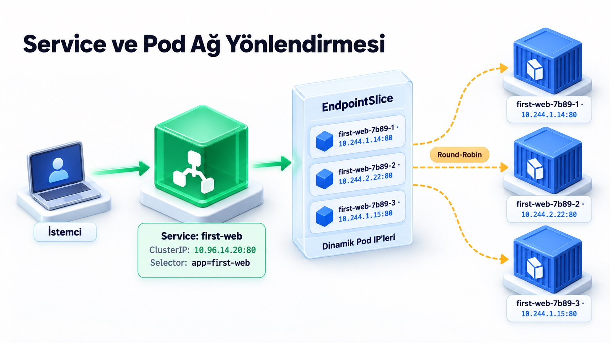

# * İlk Uygulaman: Pod, Deployment, Service ve DNS

> **Seviye:** Başlangıç
> **Tahmini süre:** 100–120 dakika
> **Eğitim durumu:** Zorunlu

## Amaç

Kubernetes küme mimarisini anlamak; Pod, Deployment ve dört Service türünün davranışını aynı uygulama üzerinde incelemek; `describe`, `logs` ve `exec` komutlarıyla çalışan konteynerleri denetlemek; Service Discovery, cluster DNS ve EndpointSlice davranışını uygulamalı olarak öğrenmek.

## Temel Kubernetes Mimarisi

[](images/k8s-architecture.jpg)
*(Görseli tam boyutta büyütmek için üzerine tıklayabilirsiniz)*

## Kullanılan Kubernetes nesneleri

- **Pod:** Kubernetes'in en küçük dağıtılabilir birimidir; bir veya birden fazla konteyneri, depolama ve IP adresini paylaşır.
- **Deployment:** İstenen Pod sayısını (ReplicaSet) korur, kendini onarır (self-healing) ve kesintisiz sürüm güncellemelerini yönetir.
- **Service:** Değişken Pod IP'lerinin önüne sabit bir ağ adresi, DNS kaydı ve yük dağıtıcı (load balancer) koyar.
- **EndpointSlice:** Service tarafından seçilen Pod IP'lerini ölçeklenebilir gruplar halinde tutar.
- **CoreDNS:** Service adlarını cluster içindeki sabit DNS kayıtlarına dönüştürür.

## Çalışma dizini

```bash
cd ~/k8s-labs/beginner/lab-02-pod-deployment-service
```

## Erişim

- URL: `http://SUNUCU_IP:30086`
- Kimlik doğrulaması: yok

## 1. İlk Pod Manifestini Uygula ve Konteyneri Keşfet (Explore & Debug)

`starter/pod.yaml` manifesti tek bir Nginx konteynerini çalıştıran temel bir Pod tanımlar:

```yaml
apiVersion: v1
kind: Pod
metadata:
  name: first-web
  labels:
    app: first-web
spec:
  containers:
    - name: web
      image: nginx:1.27-alpine
      ports:
        - containerPort: 80
```

Pod'u kümeye uygula:

```bash
kubectl apply -f starter/pod.yaml
```

Pod'un çalıştığını ve hangi node üzerine yerleştiğini kontrol et:

```bash
kubectl get pods -o wide --show-labels
```

Beklenen sonuç: `first-web` Pod'u `Running` durumuna gelir, bir IP adresi alır ve etiketinde `app=first-web` listelenir.

### Pod Durumu ve Olayları (Events) İnceleme

Konteynerin nasıl çekildiğini, başlatıldığını ve olası hataları görmek için:

```bash
kubectl describe pod first-web
```

Beklenen sonuç: En alttaki `Events` tablosunda `Scheduled`, `Pulling`, `Pulled` ve `Started` adımları listelenir.

### Konteyner Standart Çıktı Loglarını Okuma

```bash
kubectl logs first-web
```

Beklenen sonuç: Nginx'in başlangıç logları (`Configuration complete; ready for start up`) ekrana dökülür.

### Konteyner İçinde Canlı Komut Çalıştırma (`exec`)

Konteyner içine girmeden doğrudan komut çalıştırmak veya ortam değişkenlerini denetlemek için:

```bash
kubectl exec first-web -- nginx -v
kubectl exec first-web -- env
```

Beklenen sonuç: Nginx sürümü ve pod içindeki ortam değişkenleri başarıyla listelenir.

---

## 2. Tek Pod ile Controller Farkını Gör (Self-Healing Kanıtı)

Pod'u sil ve listeyi kontrol et:

```bash
kubectl delete pod first-web
kubectl get pods
```

Beklenen sonuç: `first-web` geri gelmez (`No resources found`). Çünkü tek başına açılan bir Pod'u denetleyen bir controller (Deployment/ReplicaSet) yoktur.

---

## 3. Deployment ile Yönetim ve Ölçekleme

Deployment, istenen Pod kopyası sayısını (replica) her zaman ayakta tutar.

Önce izole bir namespace oluştur:

```bash
kubectl create namespace first-app --dry-run=client -o yaml | kubectl apply -f -
```

Aşağıdaki manifest (`starter/deployment.yaml`), 2 adet Nginx Pod'unun her zaman çalışmasını garanti eder:

```yaml
apiVersion: apps/v1
kind: Deployment
metadata:
  name: web
  namespace: first-app
  labels:
    app: web
spec:
  replicas: 2
  selector:
    matchLabels:
      app: web
  template:
    metadata:
      labels:
        app: web
    spec:
      containers:
        - name: web
          image: nginx:1.27-alpine
          ports:
            - containerPort: 80
```

Manifesti cluster'a uygula:

```bash
kubectl apply -f starter/deployment.yaml
kubectl -n first-app get deployment,replicaset,pods
```

Beklenen sonuç: 1 Deployment, 1 ReplicaSet ve 2 adet `web-...` Pod'u listelenir.

Pod sayısını 3'e çıkar (Scale-out):

```bash
kubectl -n first-app scale deployment/web --replicas=3
kubectl -n first-app get pods -l app=web
```

Beklenen sonuç: Anında 3 adet Pod `Running` duruma gelir.

---

## 4. Self-Healing (Kendini Onarma) Davranışını Kanıtla

Pod'lardan birini elle sil ve Deployment'ın eksilen pod yerine anında yenisini üretmesini izle:

```bash
POD_ADI=$(kubectl -n first-app get pods -l app=web -o jsonpath='{.items[0].metadata.name}')
echo "Silinen Pod: $POD_ADI"
kubectl -n first-app delete pod "$POD_ADI"
```

Canlı olarak ReplicaSet'in yeni pod yaratmasını gözlemle:

```bash
kubectl -n first-app get pods -l app=web
```

Beklenen sonuç: Silinen pod yok edilirken, Deployment hemen yeni isimli üçüncü bir Pod üreterek toplam sayıyı 3'te tutar.

---

## 5. ClusterIP Service ve Label/Selector Eşlemesi

Pod IP'leri dinamiktir ve sürekli değişebilir. `Service`, Pod'lara sabit bir iç DNS adı ve IP sağlar.

### Service & Label Selector Çalışma Şeması

[](images/service-pod-routing.jpg)
*(Görseli tam boyutta büyütmek için üzerine tıklayabilirsiniz)*

`starter/service-clusterip.yaml` manifesti, `app: web` etiketine sahip tüm pod'ları 80 portundan tek bir iç serviste toplar:

```yaml
apiVersion: v1
kind: Service
metadata:
  name: web-clusterip
  namespace: first-app
spec:
  type: ClusterIP
  selector:
    app: web
  ports:
    - name: http
      port: 80
      targetPort: 80
```

Servisi uygula:

```bash
kubectl apply -f starter/service-clusterip.yaml
kubectl -n first-app get service web-clusterip
```

Küme içinden test yapmak için geçici bir `curl-inside` Pod'u çalıştır:

```bash
kubectl -n first-app run curl-inside --image=curlimages/curl:8.12.1 --restart=Never -- sleep 3600
kubectl -n first-app wait --for=condition=Ready pod/curl-inside --timeout=90s
```

Test Pod'undan servis adına istek gönder:

```bash
kubectl -n first-app exec curl-inside -- curl -I http://web-clusterip
```

Beklenen sonuç: `HTTP/1.1 200 OK`. Servis adı (`web-clusterip`) küme DNS'i tarafından otomatik olarak arka plandaki 3 Pod'dan birine yönlendirilir.

Test Pod'unu temizle:

```bash
kubectl -n first-app delete pod curl-inside
```

---

## 6. NodePort, ExternalName ve LoadBalancer Türlerini Dene

Hazır manifest (`starter/service-types.yaml`), aynı Deployment için dış dünyaya erişim sağlayan servis türlerini tanımlar:

```yaml
apiVersion: v1
kind: Service
metadata:
  name: web-nodeport
  namespace: first-app
spec:
  type: NodePort
  selector:
    app: web
  ports:
    - name: http
      port: 80
      targetPort: 80
      nodePort: 30086
---
apiVersion: v1
kind: Service
metadata:
  name: external-docs
  namespace: first-app
spec:
  type: ExternalName
  externalName: kubernetes.io
---
apiVersion: v1
kind: Service
metadata:
  name: web-loadbalancer
  namespace: first-app
spec:
  type: LoadBalancer
  selector:
    app: web
  ports:
    - name: http
      port: 80
      targetPort: 80
```

Manifesti uygula:

```bash
kubectl apply -f starter/service-types.yaml
kubectl -n first-app get services
```

Beklenen sonuç:
- `web-nodeport` servisi `30086` portunda dinler.
- `external-docs` harici `kubernetes.io` adresine yönlendiren bir CNAME takma adıdır.
- `web-loadbalancer` Kind üzerinde bulut yük dengeleyicisi olmadığı için `EXTERNAL-IP: <pending>` kalır.

Sunucu IP adresinden veya yerelden NodePort ile test et:

```bash
curl -I http://SUNUCU_IP:30086
```

Beklenen sonuç: `HTTP/1.1 200 OK`. Bu lab ile küme mimarisini, Pod hata ayıklamayı (`describe`, `logs`, `exec`), Deployment self-healing mantığını ve Service yönlendirme türlerini uygulamış oldunuz.

---

## 7. Service Discovery ve Kubernetes DNS

Bu bölümde değişebilen Pod IP'leri yerine Service adını kullanacak, aynı namespace ve farklı namespace içinden DNS çözümlemesini karşılaştıracak ve Service ile EndpointSlice ilişkisini inceleyeceksiniz.

Hazır manifest, `first-app` namespace'inde bir test istemcisi ve farklı namespace içinde ikinci bir test istemcisi oluşturur. Önceki adımlarda oluşturduğunuz `web` Deployment'ı ve `web-clusterip` Service'i kullanılmaya devam eder.

```bash
kubectl apply -f starter/service-discovery.yaml
kubectl wait -n first-app --for=condition=Ready pod/client-same --timeout=90s
kubectl wait -n dns-client --for=condition=Ready pod/client-other --timeout=90s
```

Pod IP'leri ile Service ClusterIP adresini karşılaştırın:

```bash
kubectl get pods -n first-app -l app=web -o wide
kubectl get service web-clusterip -n first-app -o wide
```

Pod IP'leri değişebilir; Service ClusterIP adresi ve DNS adı uygulamalar için sabit erişim noktası sağlar.

### Aynı namespace içinde kısa DNS adını kullan

```bash
kubectl exec -n first-app client-same -- curl -sI http://web-clusterip
```

Beklenen sonuç: `HTTP/1.1 200 OK`. CoreDNS kısa adı aynı namespace içinde `web-clusterip.first-app.svc.cluster.local` adına tamamlar.

### Farklı namespace içinden Service'e eriş

Önce yalnızca kısa adı deneyin:

```bash
kubectl exec -n dns-client client-other -- \
  curl -sI --connect-timeout 3 http://web-clusterip || echo "Kısa ad bu namespace'te bulunamadı"
```

Beklenen sonuç: Kısa ad `dns-client` namespace'inde aranacağı için bağlantı kurulamaz.

Namespace içeren ad ve tam cluster DNS adıyla tekrar deneyin:

```bash
kubectl exec -n dns-client client-other -- curl -sI http://web-clusterip.first-app
kubectl exec -n dns-client client-other -- \
  curl -sI http://web-clusterip.first-app.svc.cluster.local
```

Beklenen sonuç: Her iki komut da `HTTP/1.1 200 OK` döndürür.

### DNS kaydını ve EndpointSlice'ı incele

```bash
kubectl exec -n dns-client client-other -- \
  nslookup web-clusterip.first-app.svc.cluster.local
kubectl get service web-clusterip -n first-app
kubectl get endpointslice -n first-app \
  -l kubernetes.io/service-name=web-clusterip
```

DNS sorgusunda görülen adres Service ClusterIP adresiyle; EndpointSlice adresleri ise `app=web` label'ına sahip Pod IP'leriyle eşleşmelidir.

### Label değişikliğinin Service endpoint'ine etkisini gör

Pod adlarından birini değişkene alın ve Service'in kullandığı label'ı değiştirin:

```bash
WEB_POD="$(kubectl get pod -n first-app -l app=web -o jsonpath='{.items[0].metadata.name}')"
echo "$WEB_POD"
kubectl label pod -n first-app "$WEB_POD" app=disabled --overwrite
kubectl get endpointslice -n first-app \
  -l kubernetes.io/service-name=web-clusterip
kubectl get pods -n first-app --show-labels
```

Beklenen sonuç: Değiştirilen Pod EndpointSlice listesinden çıkar. ReplicaSet eksilen eşleşen Pod yerine yeni bir `app=web` Pod'u oluşturur. Label'ı değiştirilmiş eski Pod çalışmaya devam ettiği için geçici olarak toplam Pod sayısı artabilir.

Eski Pod'u silip Deployment ve Service durumunu tekrar doğrulayın:

```bash
kubectl delete pod -n first-app "$WEB_POD"
kubectl rollout status deployment/web -n first-app --timeout=120s
kubectl get endpointslice -n first-app \
  -l kubernetes.io/service-name=web-clusterip
```

## Başarı kriterleri

- Tek Pod ile Deployment arasındaki self-healing farkını gördünüz.
- Deployment'ı üç replikaya ölçeklediniz.
- ClusterIP Service üzerinden küme içinden erişebildiniz.
- NodePort, ExternalName ve LoadBalancer türlerinin farkını açıklayabiliyorsunuz.
- Aynı ve farklı namespace'lerden Service DNS adını kullanabildiniz.
- Label değişikliğinin EndpointSlice üzerindeki etkisini doğruladınız.

## Temizlik

```bash
kubectl delete namespace first-app
kubectl delete namespace dns-client --ignore-not-found
kubectl delete pod first-web --ignore-not-found
```
