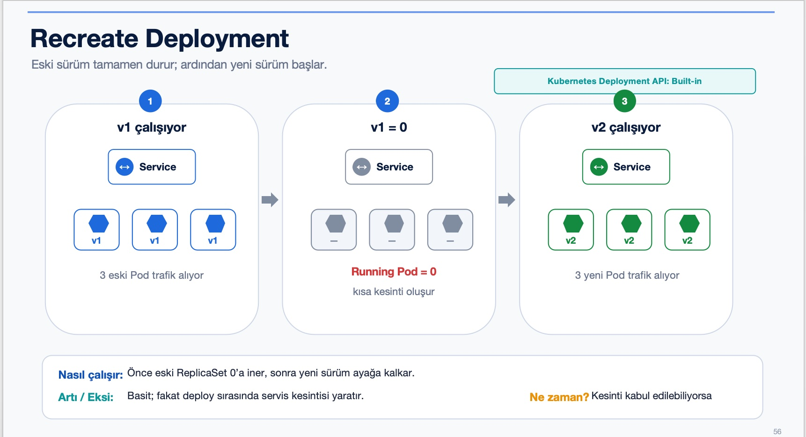
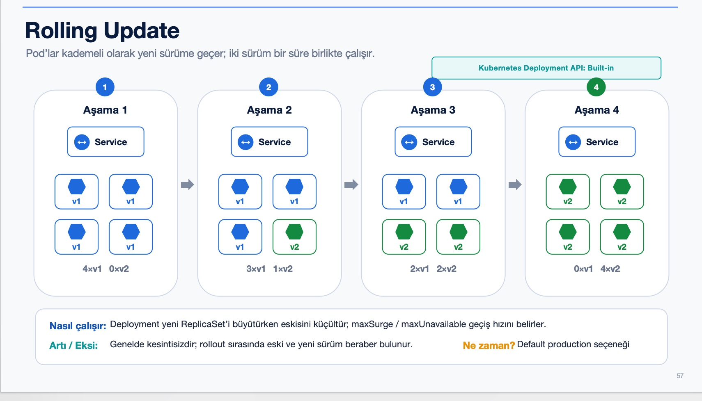

# Recreate ve RollingUpdate ile Sürüm Güncelleme

> **Seviye:** Orta
> **Tahmini süre:** 55–70 dakika
> **Eğitim durumu:** Orta seviye çekirdek

## Amaç

Bu labda aynı uygulamanın `1.0` ve `2.0` sürümlerini oluşturacak; Recreate stratejisindeki kesintiyi, RollingUpdate stratejisindeki kesintisiz geçişi ve rollback işlemini canlı trafikle gözlemleyeceksiniz.

## Kullanılan Kubernetes nesneleri

- **Deployment:** Uygulama sürümünü ve güncelleme stratejisini yönetir.
- **Service:** Güncelleme sırasında Pod'lara sabit bir erişim adresi sağlar.
- **Readiness probe:** Hazır olmayan yeni Pod'un trafik almasını engeller.

## Çalışma dizini

```bash
cd ~/k8s-labs/intermediate/lab-05-recreate-and-rolling-update
```

## 1. İki uygulama sürümünü hazırla

Bu lab image'ları Docker Hub'a göndermez. Image'ları yerel olarak oluşturup doğrudan Kind node'larına yükler.

```bash
export IMAGE="devops-app"

docker build -t "${IMAGE}:1.0" ~/k8s-labs/app/devops-app
docker build --build-arg APP_VERSION=2.0 -t "${IMAGE}:2.0" ~/k8s-labs/app/devops-app

kind load docker-image "${IMAGE}:1.0" "${IMAGE}:2.0" --name k8s-labs
```

Image'ların Kind node'larında bulunduğunu doğrulayın:

```bash
docker exec k8s-labs-control-plane crictl images | grep devops-app
```

Beklenen sonuç: `1.0` ve `2.0` etiketleri görünür.

## 2. Namespace ve test istemcisini oluştur

```bash
kubectl create namespace private-app --dry-run=client -o yaml | kubectl apply -f -
kubectl run test-client -n private-app \
  --image=curlimages/curl:8.12.1 --restart=Never -- sleep 3600
kubectl wait -n private-app --for=condition=Ready pod/test-client --timeout=90s
```

## 3. Recreate stratejisini uygula

[](images/recreate-infographic.jpg)

[Recreate Mermaid akışını aç](diagrams/recreate.md)

Recreate stratejisi eski Pod'ların tamamını kapattıktan sonra yeni sürümü başlatır. Manifestteki dört saniyelik başlangıç gecikmesi, kesintinin eğitim sırasında açıkça görülmesini sağlar.

```bash
sed "s|__IMAGE__|${IMAGE}|g" starter/recreate.yaml | kubectl apply -f -
kubectl rollout status deployment/devops-app-recreate -n private-app --timeout=120s
kubectl exec -n private-app test-client -- curl -s http://strategy-recreate/
```

Beklenen sonuçta `"version":"1.0"` görünür.

### Kesintiyi canlı izle

Birinci terminalde sürekli istek gönderin:

```bash
kubectl exec -n private-app test-client -- sh -c \
  'while true; do curl -s --connect-timeout 1 http://strategy-recreate/ || echo KESINTI; sleep 0.5; done'
```

İkinci terminalde sürümü güncelleyin:

```bash
kubectl set image deployment/devops-app-recreate -n private-app app="${IMAGE}:2.0"
kubectl rollout status deployment/devops-app-recreate -n private-app --timeout=120s
```

Birinci terminalde bir süre `KESINTI`, ardından `"version":"2.0"` görünür. İzlemeyi `Ctrl+C` ile durdurun.

Pod değişimini inceleyin:

```bash
kubectl get pods -n private-app -l app=devops-app-recreate
kubectl rollout history deployment/devops-app-recreate -n private-app
```

Recreate kaynaklarını temizleyin:

```bash
kubectl delete deployment devops-app-recreate -n private-app
kubectl delete service strategy-recreate -n private-app
```

## 4. RollingUpdate stratejisini uygula

[](images/rolling-update-infographic.jpg)

[RollingUpdate Mermaid akışını aç](diagrams/rolling-update.md)

Bu manifest `maxUnavailable: 0` ve `maxSurge: 1` kullanır. Yeni Pod hazır olmadan eski Pod kapatılmaz.

```bash
sed "s|__IMAGE__|${IMAGE}|g" starter/rolling.yaml | kubectl apply -f -
kubectl rollout status deployment/devops-app-rolling -n private-app --timeout=120s
kubectl exec -n private-app test-client -- curl -s http://strategy-rolling/
```

Beklenen sonuçta `"version":"1.0"` görünür.

### Kesintisiz geçişi canlı izle

Birinci terminalde istek döngüsünü başlatın:

```bash
kubectl exec -n private-app test-client -- sh -c \
  'while true; do curl -s --connect-timeout 1 http://strategy-rolling/ || echo HATA; sleep 0.5; done'
```

İkinci terminalde güncellemeyi başlatın ve Pod'ları izleyin:

```bash
kubectl set image deployment/devops-app-rolling -n private-app app="${IMAGE}:2.0"
kubectl get pods -n private-app -l app=devops-app-rolling -w
```

Yeni Pod'lar sırayla hazır olur. Birinci terminalde `HATA` görülmemeli; yanıtlar `1.0` sürümünden `2.0` sürümüne geçmelidir. İzlemeleri `Ctrl+C` ile durdurun.

Güncellemenin tamamlandığını doğrulayın:

```bash
kubectl rollout status deployment/devops-app-rolling -n private-app --timeout=120s
kubectl exec -n private-app test-client -- curl -s http://strategy-rolling/
```

## 5. Rollback yap

```bash
kubectl rollout undo deployment/devops-app-rolling -n private-app
kubectl rollout status deployment/devops-app-rolling -n private-app --timeout=120s
kubectl exec -n private-app test-client -- curl -s http://strategy-rolling/
```

Beklenen sonuç: Uygulama yeniden `"version":"1.0"` yanıtı verir.

## Başarı kriterleri

- Recreate güncellemesinde trafik kesintisini gördünüz.
- RollingUpdate sırasında isteklerin cevap vermeye devam ettiğini doğruladınız.
- `maxUnavailable` ve `maxSurge` değerlerinin görevini açıklayabiliyorsunuz.
- Deployment'ı önceki sürüme geri alabildiniz.

## Hızlı öğrenci ek görevi

```bash
kubectl rollout history deployment/devops-app-rolling -n private-app
kubectl rollout undo deployment/devops-app-rolling -n private-app --to-revision=2
```

## Temizlik

```bash
kubectl delete namespace private-app
```
