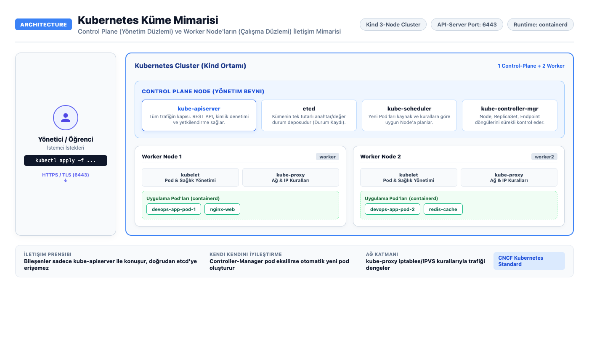
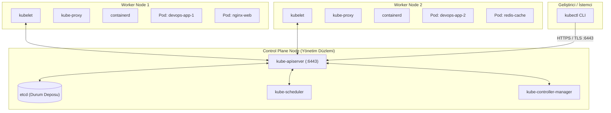
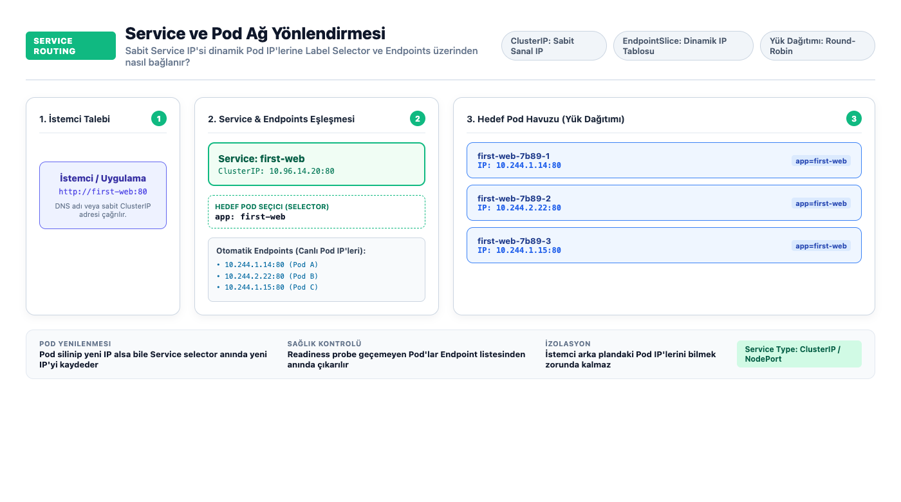
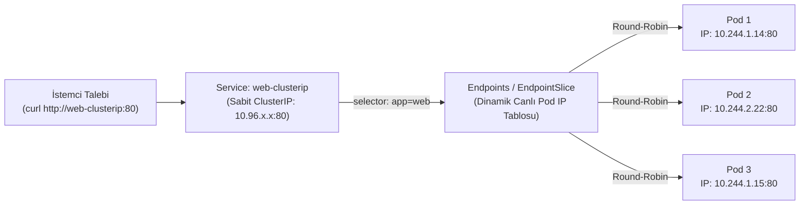

# * İlk Uygulaman: Pod, Deployment ve Service

## Amaç

Kubernetes küme mimarisini anlamak; Pod, Deployment ve dört Service türünün davranışını aynı uygulama üzerinde incelemek; `describe`, `logs` ve `exec` komutlarıyla çalışan konteynerleri denetleyip hata ayıklamayı öğrenmek.

## Temel Kubernetes Mimarisi

[](images/k8s-architecture.png)
*(Görseli tam boyutta büyütmek için üzerine tıklayabilirsiniz)*



## Kullanılan Kubernetes nesneleri

- **Pod:** Kubernetes'in en küçük dağıtılabilir birimidir; bir veya birden fazla konteyneri, depolama ve IP adresini paylaşır.
- **Deployment:** İstenen Pod sayısını (ReplicaSet) korur, kendini onarır (self-healing) ve kesintisiz sürüm güncellemelerini yönetir.
- **Service:** Değişken Pod IP'lerinin önüne sabit bir ağ adresi, DNS kaydı ve yük dağıtıcı (load balancer) koyar.

## Çalışma dizini

```bash
cd ~/k8s-labs/lab-01-first-app-pod-deployment-and-services
```

## Erişim

- URL: `http://SUNUCU_IP:30086`
- Kimlik doğrulaması: yok

## Başlamadan önce

Kind cluster çalışır durumda olmalıdır:

```bash
kubectl get nodes -o wide
```

Beklenen sonuç: 1 control-plane ve 2 worker node `Ready` durumunda görünmelidir.

---

## 1. İlk Pod Manifestini Uygula ve Konteyneri Keşfet (Explore & Debug)

`starter/pod.yaml` manifesti tek bir Nginx konteynerini çalıştıran temel bir Pod tanımlar:

```yaml
apiVersion: v1
kind: Pod
metadata:
  name: first-web
  labels:
    app: first-web
spec:
  containers:
    - name: web
      image: nginx:1.27-alpine
      ports:
        - containerPort: 80
```

Pod'u kümeye uygula:

```bash
kubectl apply -f starter/pod.yaml
```

Pod'un çalıştığını ve hangi node üzerine yerleştiğini kontrol et:

```bash
kubectl get pods -o wide --show-labels
```

Beklenen sonuç: `first-web` Pod'u `Running` durumuna gelir, bir IP adresi alır ve etiketinde `app=first-web` listelenir.

### Pod Durumu ve Olayları (Events) İnceleme

Konteynerin nasıl çekildiğini, başlatıldığını ve olası hataları görmek için:

```bash
kubectl describe pod first-web
```

Beklenen sonuç: En alttaki `Events` tablosunda `Scheduled`, `Pulling`, `Pulled` ve `Started` adımları listelenir.

### Konteyner Standart Çıktı Loglarını Okuma

```bash
kubectl logs first-web
```

Beklenen sonuç: Nginx'in başlangıç logları (`Configuration complete; ready for start up`) ekrana dökülür.

### Konteyner İçinde Canlı Komut Çalıştırma (`exec`)

Konteyner içine girmeden doğrudan komut çalıştırmak veya ortam değişkenlerini denetlemek için:

```bash
kubectl exec first-web -- nginx -v
kubectl exec first-web -- env
```

Beklenen sonuç: Nginx sürümü ve pod içindeki ortam değişkenleri başarıyla listelenir.

---

## 2. Tek Pod ile Controller Farkını Gör (Self-Healing Kanıtı)

Pod'u sil ve listeyi kontrol et:

```bash
kubectl delete pod first-web
kubectl get pods
```

Beklenen sonuç: `first-web` geri gelmez (`No resources found`). Çünkü tek başına açılan bir Pod'u denetleyen bir controller (Deployment/ReplicaSet) yoktur.

---

## 3. Deployment ile Yönetim ve Ölçekleme

Deployment, istenen Pod kopyası sayısını (replica) her zaman ayakta tutar.

Önce izole bir namespace oluştur:

```bash
kubectl create namespace first-app --dry-run=client -o yaml | kubectl apply -f -
```

Aşağıdaki manifest (`starter/deployment.yaml`), 2 adet Nginx Pod'unun her zaman çalışmasını garanti eder:

```yaml
apiVersion: apps/v1
kind: Deployment
metadata:
  name: web
  namespace: first-app
  labels:
    app: web
spec:
  replicas: 2
  selector:
    matchLabels:
      app: web
  template:
    metadata:
      labels:
        app: web
    spec:
      containers:
        - name: web
          image: nginx:1.27-alpine
          ports:
            - containerPort: 80
```

Manifesti cluster'a uygula:

```bash
kubectl apply -f starter/deployment.yaml
kubectl -n first-app get deployment,replicaset,pods
```

Beklenen sonuç: 1 Deployment, 1 ReplicaSet ve 2 adet `web-...` Pod'u listelenir.

Pod sayısını 3'e çıkar (Scale-out):

```bash
kubectl -n first-app scale deployment/web --replicas=3
kubectl -n first-app get pods -l app=web
```

Beklenen sonuç: Anında 3 adet Pod `Running` duruma gelir.

---

## 4. Self-Healing (Kendini Onarma) Davranışını Kanıtla

Pod'lardan birini elle sil ve Deployment'ın eksilen pod yerine anında yenisini üretmesini izle:

```bash
POD_ADI=$(kubectl -n first-app get pods -l app=web -o jsonpath='{.items[0].metadata.name}')
echo "Silinen Pod: $POD_ADI"
kubectl -n first-app delete pod "$POD_ADI"
```

Canlı olarak ReplicaSet'in yeni pod yaratmasını gözlemle:

```bash
kubectl -n first-app get pods -l app=web
```

Beklenen sonuç: Silinen pod yok edilirken, Deployment hemen yeni isimli üçüncü bir Pod üreterek toplam sayıyı 3'te tutar.

---

## 5. ClusterIP Service ve Label/Selector Eşlemesi

Pod IP'leri dinamiktir ve sürekli değişebilir. `Service`, Pod'lara sabit bir iç DNS adı ve IP sağlar.

### Service & Label Selector Çalışma Şeması

[](images/service-pod-routing.png)
*(Görseli tam boyutta büyütmek için üzerine tıklayabilirsiniz)*



`starter/service-clusterip.yaml` manifesti, `app: web` etiketine sahip tüm pod'ları 80 portundan tek bir iç serviste toplar:

```yaml
apiVersion: v1
kind: Service
metadata:
  name: web-clusterip
  namespace: first-app
spec:
  type: ClusterIP
  selector:
    app: web
  ports:
    - name: http
      port: 80
      targetPort: 80
```

Servisi uygula:

```bash
kubectl apply -f starter/service-clusterip.yaml
kubectl -n first-app get service web-clusterip
```

Küme içinden test yapmak için geçici bir `curl-inside` Pod'u çalıştır:

```bash
kubectl -n first-app run curl-inside --image=curlimages/curl:8.12.1 --restart=Never -- sleep 3600
kubectl -n first-app wait --for=condition=Ready pod/curl-inside --timeout=90s
```

Test Pod'undan servis adına istek gönder:

```bash
kubectl -n first-app exec curl-inside -- curl -I http://web-clusterip
```

Beklenen sonuç: `HTTP/1.1 200 OK`. Servis adı (`web-clusterip`) küme DNS'i tarafından otomatik olarak arka plandaki 3 Pod'dan birine yönlendirilir.

Test Pod'unu temizle:

```bash
kubectl -n first-app delete pod curl-inside
```

---

## 6. NodePort, ExternalName ve LoadBalancer Türlerini Dene

Hazır manifest (`starter/service-types.yaml`), aynı Deployment için dış dünyaya erişim sağlayan servis türlerini tanımlar:

```yaml
apiVersion: v1
kind: Service
metadata:
  name: web-nodeport
  namespace: first-app
spec:
  type: NodePort
  selector:
    app: web
  ports:
    - name: http
      port: 80
      targetPort: 80
      nodePort: 30086
---
apiVersion: v1
kind: Service
metadata:
  name: external-docs
  namespace: first-app
spec:
  type: ExternalName
  externalName: kubernetes.io
---
apiVersion: v1
kind: Service
metadata:
  name: web-loadbalancer
  namespace: first-app
spec:
  type: LoadBalancer
  selector:
    app: web
  ports:
    - name: http
      port: 80
      targetPort: 80
```

Manifesti uygula:

```bash
kubectl apply -f starter/service-types.yaml
kubectl -n first-app get services
```

Beklenen sonuç:
- `web-nodeport` servisi `30086` portunda dinler.
- `external-docs` harici `kubernetes.io` adresine yönlendiren bir CNAME takma adıdır.
- `web-loadbalancer` Kind üzerinde bulut yük dengeleyicisi olmadığı için `EXTERNAL-IP: <pending>` kalır.

Sunucu IP adresinden veya yerelden NodePort ile test et:

```bash
curl -I http://SUNUCU_IP:30086
```

Beklenen sonuç: `HTTP/1.1 200 OK`. Bu lab ile küme mimarisini, Pod hata ayıklamayı (`describe`, `logs`, `exec`), Deployment self-healing mantığını ve Service yönlendirme türlerini uygulamış oldunuz.
