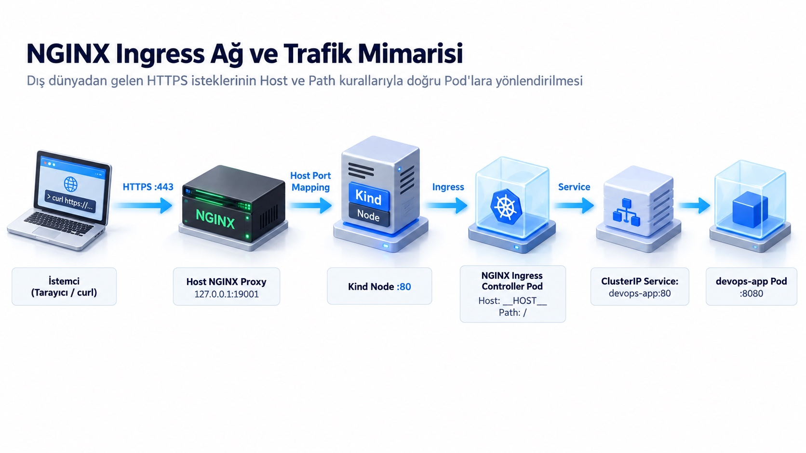

# * Uygulamanı NGINX Ingress ile İnternete Aç

## Amaç

Uygulamayı NGINX Ingress Controller kullanarak öğrenci DNS adı üzerinden internete ve dış dünyaya açmak.

## Kullanılan Kubernetes nesneleri

- **Ingress:** HTTP/HTTPS isteklerini (host ve path) doğru Service'e yönlendiren kural kümesidir.
- **Ingress Controller:** Ingress kurallarını okuyup trafiği gerçek zamanlı yönlendiren ve yük dengeleyen Pod'lardır (NGINX tabanlı).
- **Service:** Ingress'in yönlendirdiği hedef uygulama servisidir.
- **Deployment & ConfigMap:** Ingress arkasında çalışan örnek backend uygulamasıdır.

## Çalışma dizini

```bash
cd ~/k8s-labs/lab-03-nginx-ingress-routing
```

## Trafik mimarisi nasıl çalışır?

[](images/ingress-traffic-flow.jpg)
*(Görseli tam boyutta büyütmek için üzerine tıklayabilirsiniz)*

```text
İstemci (Tarayıcı / curl)
  → DNS / Cloudflare HTTPS (:443)
  → Host Edge Nginx
  → 127.0.0.1:19001 (Host Portu)
  → Kind control-plane :80 (Container Portu)
  → NGINX Ingress Controller Pod
  → private-app/devops-app Service (:80)
  → devops-app Pod
```

---

## 1. Uygulama ortamını ayağa kaldır

Bu lab tamamen bağımsızdır; önceki lablara ihtiyaç duymaz.

Aşağıdaki manifest (`starter/app.yaml`), `private-app` adında bir namespace, `/healthz` adresine `{"status":"UP"}` yanıtı veren bir NGINX Deployment'ı ve bu pod'ları 80 portundan açan bir Service tanımlar:

```yaml
apiVersion: v1
kind: Namespace
metadata:
  name: private-app
---
apiVersion: v1
kind: ConfigMap
metadata:
  name: devops-app-config
  namespace: private-app
data:
  default.conf: |
    server {
        listen 80;
        default_type application/json;
        location /healthz {
            return 200 '{"status": "UP", "application": "devops-app"}\n';
        }
        location / {
            return 200 '{"status": "UP", "application": "devops-app"}\n';
        }
    }
---
apiVersion: apps/v1
kind: Deployment
metadata:
  name: devops-app
  namespace: private-app
  labels:
    app: devops-app
spec:
  replicas: 1
  selector:
    matchLabels:
      app: devops-app
  template:
    metadata:
      labels:
        app: devops-app
    spec:
      containers:
        - name: devops-app
          image: nginx:1.27-alpine
          ports:
            - containerPort: 80
              name: http
          volumeMounts:
            - name: config-volume
              mountPath: /etc/nginx/conf.d/default.conf
              subPath: default.conf
      volumes:
        - name: config-volume
          configMap:
            name: devops-app-config
---
apiVersion: v1
kind: Service
metadata:
  name: devops-app
  namespace: private-app
  labels:
    app: devops-app
spec:
  type: ClusterIP
  selector:
    app: devops-app
  ports:
    - name: http
      port: 80
      targetPort: 80
```

Bu manifesti cluster'a uygula ve pod'un hazır olmasını bekle:

```bash
kubectl apply -f starter/app.yaml
kubectl -n private-app rollout status deployment/devops-app
kubectl -n private-app get pods,service
```

Beklenen sonuç: `devops-app` Deployment'ı, `Running` durumunda bir Pod ve `devops-app` Service'i listelenir.

---

## 2. NGINX Ingress Controller'ı kur

Ingress kaynağı tek başına sadece bir kuraldır; bu kuralı okuyup trafiği yönlendiren bir Ingress Controller gerekir.

> [!NOTE]
> Kind ortamında Ingress Controller `control-plane` node'unun 80 portunu (`hostPort: 80`) kullanır. Kümede bu portu kullanan başka bir Ingress (örn. Traefik) varsa çakışmaması için önce kaldırılmalıdır:
> `helm uninstall traefik -n traefik 2>/dev/null || true`

Resmi Kind NGINX Ingress manifestini kur ve Controller Pod'unun hazır olmasını bekle:

```bash
kubectl apply -f https://github.com/kubernetes/ingress-nginx/raw/controller-v1.12.0/deploy/static/provider/kind/deploy.yaml
kubectl wait --namespace ingress-nginx --for=condition=Ready pod \
  --selector=app.kubernetes.io/component=controller --timeout=180s
kubectl wait --namespace ingress-nginx \
  --for=condition=Complete job/ingress-nginx-admission-patch --timeout=180s
kubectl get pods -n ingress-nginx
```

Beklenen sonuç: `ingress-nginx-controller` Pod'u `Running` (1/1) durumuna gelir.

---

## 3. Kendi DNS adını değişkene ata

Sunucu adınızı otomatik almak ve değişkene atamak için:

```bash
export STUDENT_ID="${STUDENT_ID:-$(hostname)}"
export APP_HOST="${STUDENT_ID}-app1.devopsatolyesi.com"
echo "Hedef Host: $APP_HOST"
```

Beklenen sonuç: `student101-app1.devopsatolyesi.com` (veya size atanan öğrenci numarası) görünür.

---

## 4. Ingress manifestini incele ve uygula

Aşağıdaki Ingress manifesti (`starter/ingress.yaml`), `ingressClassName: nginx` kullanarak kuralı NGINX Controller'a bağlar ve gelen host adresini `devops-app` servisinin 80 portuna yönlendirir:

```yaml
apiVersion: networking.k8s.io/v1
kind: Ingress
metadata:
  name: devops-app
  namespace: private-app
spec:
  ingressClassName: nginx            # Kuralı okuyacak controller
  rules:
    - host: __APP_HOST__             # Dışarıdan gelecek alan adı
      http:
        paths:
          - path: /                  # Tüm istek yolları
            pathType: Prefix
            backend:
              service:
                name: devops-app     # Hedef Kubernetes servisi
                port:
                  number: 80         # Hedef servis portu
```

Starter dosyasını kopyala, `sed` komutuyla `__APP_HOST__` şablonunu kendi DNS adınla değiştir ve cluster'a uygula:

```bash
cp starter/ingress.yaml ingress.local.yaml
sed -i "s/__APP_HOST__/${APP_HOST}/g" ingress.local.yaml
kubectl apply -f ingress.local.yaml
```

Oluşan Ingress kuralını incele:

```bash
kubectl -n private-app get ingress devops-app
kubectl -n private-app describe ingress devops-app
```

Beklenen sonuç: Ingress kuralında kendi hostname'iniz ve backend olarak `devops-app:80` görünür.

---

## 5. Doğrudan Kind giriş portunu test et (Port 19001)

Bu test DNS veya TLS katmanına girmeden, doğrudan Kind'in 19001 portuna Host header göndererek Ingress kuralını doğrular.

```bash
curl -i -H "Host: ${APP_HOST}" http://127.0.0.1:19001/healthz
```

Beklenen sonuç: `HTTP/1.1 200 OK` koduyla birlikte JSON çıktısı görünür:
```json
{"status": "UP", "application": "devops-app"}
```

---

## 6. Öğrenci DNS adı ve HTTPS ile test et

Bu test tüm internet akışını doğrular: DNS → Cloudflare SSL → Edge Nginx → Kind :80 → Ingress Controller → Service → Pod.

```bash
curl -i -k "https://${APP_HOST}/healthz"
```

Beklenen sonuç: `HTTP/2 200` kodu ve aynı JSON çıktısı döner:
```json
{"status": "UP", "application": "devops-app"}
```
