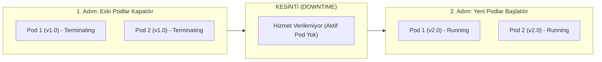
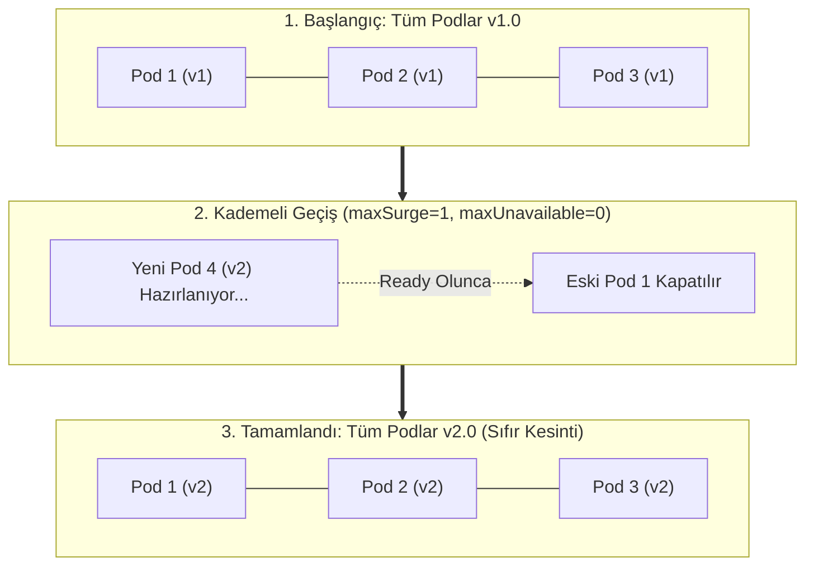
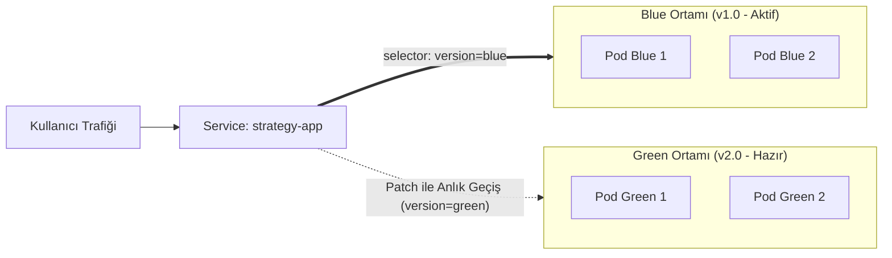
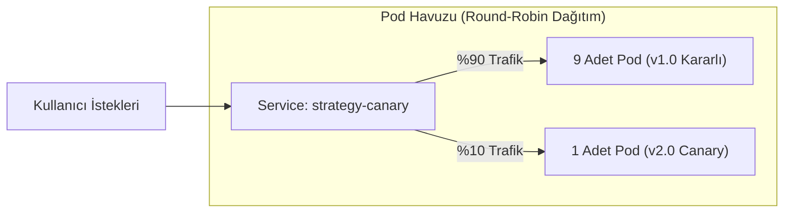

# * Sürümü Güvenle Yayınla: Recreate, Rolling, Blue-Green ve Canary

## Amaç

Modern yazılım dağıtım stratejileri olan Recreate, RollingUpdate, Blue-Green ve Canary mimarilerini; **uygulamaya içeriden `curl` istekleri göndererek canlı trafik davranışını (kesinti anı, sıfır kesinti, anlık geçiş ve yüzdelik dağılım)** uygulamalı olarak öğrenmek.

## Kullanılan Kubernetes nesneleri

- **Deployment:** Recreate, RollingUpdate ve pod sayısı ölçekleme (Canary replica scaling) ile sürüm geçişlerini yönetir.
- **Service:** Blue-Green stratejisinde pod label selector'ını anlık değiştirir; doğal Canary stratejisinde pod oranına göre trafiği dengeler.
- **Gateway & HTTPRoute (Alternatif):** Gateway API Canary stratejisinde gelen HTTP trafiğini sürümler arasında ağ katmanında yüzdelik ağırlıklarla (%90-%10, %50-%50) paylaştırır.

## Çalışma dizini

```bash
cd ~/k8s-labs/lab-08-deployment-strategies
```

---

## 1. İmaj Sürümlerini (1.0 ve 2.0) Derle ve Test İstemcisini Hazırla

Canlı güncelleme stratejilerini deneyebilmek için iki farklı sürüme (`1.0` ve `2.0`) ihtiyacımız var. Uygulama kaynak kodları `~/k8s-labs/app/devops-app` dizinindedir.

Değişkenleri tanımla:

```bash
export DOCKERHUB_USER="KENDI_DOCKERHUB_KULLANICI_ADIN"
export IMAGE="docker.io/${DOCKERHUB_USER}/devops-app"
export STUDENT_ID="${STUDENT_ID:-$(hostname)}"
export APP_HOST="${STUDENT_ID}-app1.devopsatolyesi.com"
```

Her iki sürümü de derleyip Docker Hub'a gönder:

```bash
docker login -u "$DOCKERHUB_USER"

# Sürüm 1.0 (Kararlı eski sürüm)
docker build -t "${IMAGE}:1.0" ~/k8s-labs/app/devops-app
docker push "${IMAGE}:1.0"

# Sürüm 2.0 (Yeni sürüm)
docker build --build-arg APP_VERSION=2.0 -t "${IMAGE}:2.0" ~/k8s-labs/app/devops-app
docker push "${IMAGE}:2.0"
```

Kubernetes'in Docker Hub imajlarını çekebilmesi için namespace'i hazırla, (varsa private depo için) secret'ı tanımla ve cluster içinden canlı istek gönderecek `test-client` Pod'unu başlat:

```bash
kubectl create namespace private-app --dry-run=client -o yaml | kubectl apply -f -

# Eğer Docker Hub'daki devops-app reponuz Private ise secret'ı oluşturun (Public ise gerekmez):
# kubectl -n private-app create secret docker-registry dockerhub-creds \
#   --docker-server=https://index.docker.io/v1/ --docker-username="$DOCKERHUB_USER" --docker-password="DOCKERHUB_TOKEN" \
#   --dry-run=client -o yaml | kubectl apply -f -

kubectl -n private-app patch serviceaccount default -p '{"imagePullSecrets": [{"name": "dockerhub-creds"}]}' 2>/dev/null || true

kubectl -n private-app run test-client --image=curlimages/curl:8.12.1 --restart=Never -- sleep 3600
kubectl -n private-app wait --for=condition=Ready pod/test-client --timeout=60s
```

---

## 2. Recreate Stratejisi — Kesinti Anını (Downtime) Canlı Gör

Recreate stratejisinde Kubernetes, yeni sürüm pod'larını başlatmadan önce mevcut tüm eski pod'ları sonlandırır. Bu durum servis kesintisine yol açar:



Aşağıdaki manifest (`starter/recreate.yaml`), Recreate stratejisi kullanan 2 replikalı bir Deployment ve Service tanımlar:

```yaml
apiVersion: apps/v1
kind: Deployment
metadata:
  name: devops-app-recreate
  namespace: private-app
spec:
  replicas: 2
  strategy:
    type: Recreate                  # Önce eskileri tamamen kapat, sonra yenileri aç
  selector:
    matchLabels:
      app: devops-app-recreate
  template:
    metadata:
      labels:
        app: devops-app-recreate
    spec:
      containers:
        - name: app
          image: __IMAGE__:1.0
          ports:
            - containerPort: 8080
              name: http
---
apiVersion: v1
kind: Service
metadata:
  name: strategy-recreate
  namespace: private-app
spec:
  selector:
    app: devops-app-recreate
  ports:
    - name: http
      port: 80
      targetPort: 8080
```

Manifesti imaj adınla cluster'a uygula:

```bash
sed "s|__IMAGE__|${IMAGE}|g" starter/recreate.yaml | kubectl apply -f -
kubectl -n private-app rollout status deployment/devops-app-recreate
```

Uygulamanın `1.0` sürümünde çalıştığını doğrula:

```bash
kubectl -n private-app exec test-client -- curl -s http://strategy-recreate/
```

Beklenen sonuç: `{"application":"devops-app","version":"1.0","pod":"devops-app-recreate-..."}` döner.

Şimdi imajı `2.0` sürümüne güncelle:

```bash
kubectl -n private-app set image deployment/devops-app-recreate app="${IMAGE}:2.0"
```

Güncelleme devam ederken istek döngüsünü başlat ve kesintiyi (downtime) gör:

```bash
kubectl -n private-app exec test-client -- sh -c 'for i in $(seq 1 15); do curl -s --connect-timeout 1 http://strategy-recreate/ | grep -o "\"version\":\"[^\"]*\"" || echo "KESİNTİ (Downtime): Servis kapandı!"; sleep 0.5; done'
```

Beklenen sonuç: Eski pod'lar silinirken istekler başarısız olur (`KESİNTİ (Downtime): Servis kapandı!`), yeni sürüm pod'ları hazır olduğunda ise istekler `"version":"2.0"` olarak geri döner.

Temizlik:

```bash
kubectl -n private-app delete deployment devops-app-recreate
kubectl -n private-app delete service strategy-recreate
```

---

## 3. RollingUpdate Stratejisi — Sıfır Kesintiyi (Zero Downtime) Canlı Gör

RollingUpdate, Kubernetes'in varsayılan stratejisidir. Yeni pod'lar hazır olmadan eski pod'lar kapatılmaz; böylece sıfır kesinti sağlanır:



Aşağıdaki manifest (`starter/rolling.yaml`), sıfır kesinti politikasıyla 3 replika tanımlar:

```yaml
apiVersion: apps/v1
kind: Deployment
metadata:
  name: devops-app-rolling
  namespace: private-app
spec:
  replicas: 3
  strategy:
    type: RollingUpdate
    rollingUpdate:
      maxUnavailable: 0              # Güncelleme sırasında asla eksik pod kalmasın
      maxSurge: 1                    # En fazla 1 adet ek pod açılabilsin
  selector:
    matchLabels:
      app: devops-app-rolling
  template:
    metadata:
      labels:
        app: devops-app-rolling
    spec:
      containers:
        - name: app
          image: __IMAGE__:1.0
          ports:
            - containerPort: 8080
              name: http
---
apiVersion: v1
kind: Service
metadata:
  name: strategy-rolling
  namespace: private-app
spec:
  selector:
    app: devops-app-rolling
  ports:
    - name: http
      port: 80
      targetPort: 8080
```

Manifesti uygula ve `1.0` sürümünü başlat:

```bash
sed "s|__IMAGE__|${IMAGE}|g" starter/rolling.yaml | kubectl apply -f -
kubectl -n private-app rollout status deployment/devops-app-rolling
```

Şimdi imajı `2.0` sürümüne güncelle:

```bash
kubectl -n private-app set image deployment/devops-app-rolling app="${IMAGE}:2.0"
```

Güncelleme sırasında hemen istek döngüsünü çalıştır:

```bash
kubectl -n private-app exec test-client -- sh -c 'for i in $(seq 1 15); do curl -s --connect-timeout 1 http://strategy-rolling/ | grep -o "\"version\":\"[^\"]*\""; sleep 0.5; done'
```

Beklenen sonuç:
- Hiçbir istek hata vermez (sıfır kesinti).
- Ekranda önce `"version":"1.0"`, geçiş anında pod bazında karışık `1.0` ve `2.0`, güncelleme tamamlandığında ise tamamen `"version":"2.0"` akar.

Yapılan güncellemeyi tek komutla geri al (Rollback):

```bash
kubectl -n private-app rollout undo deployment/devops-app-rolling
kubectl -n private-app rollout status deployment/devops-app-rolling
kubectl -n private-app exec test-client -- curl -s http://strategy-rolling/
```

Beklenen sonuç: Uygulama kesintisiz biçimde yeniden `1.0` sürümüne döner.

Temizlik:

```bash
kubectl -n private-app delete deployment devops-app-rolling
kubectl -n private-app delete service strategy-rolling
```

---

## 4. Blue-Green Dağıtımı — Anlık Geçişi (Instant Switch) Canlı Gör

Blue-Green stratejisinde iki bağımsız Deployment (`blue` = v1.0, `green` = v2.0) aynı anda kümede yaşar. Servis selector'ı hangi rengi işaret ederse tüm canlı trafik anında o sürüme yönlenir:



Aşağıdaki manifestte (`starter/blue-green.yaml`):
- Blue deployment'ı doğrudan `1.0` sürümünü çalıştırır.
- Green deployment'ı doğrudan `2.0` sürümünü çalıştırır.
- `strategy-app` servisi başlangıçta `version: blue` etiketini seçer:

```yaml
apiVersion: apps/v1
kind: Deployment
metadata:
  name: devops-app-blue
  namespace: private-app
spec:
  replicas: 2
  selector:
    matchLabels:
      app: strategy-app
      version: blue
  template:
    metadata:
      labels:
        app: strategy-app
        version: blue
    spec:
      containers:
        - name: app
          image: __IMAGE__:1.0
          ports:
            - containerPort: 8080
              name: http
---
apiVersion: apps/v1
kind: Deployment
metadata:
  name: devops-app-green
  namespace: private-app
spec:
  replicas: 2
  selector:
    matchLabels:
      app: strategy-app
      version: green
  template:
    metadata:
      labels:
        app: strategy-app
        version: green
    spec:
      containers:
        - name: app
          image: __IMAGE__:2.0
          ports:
            - containerPort: 8080
              name: http
---
apiVersion: v1
kind: Service
metadata:
  name: strategy-app
  namespace: private-app
spec:
  selector:
    app: strategy-app
    version: blue                    # Başlangıçta trafiği Blue (1.0) karşılar
  ports:
    - name: http
      port: 80
      targetPort: 8080
```

Manifesti cluster'a uygula:

```bash
sed "s|__IMAGE__|${IMAGE}|g" starter/blue-green.yaml | kubectl apply -f -
kubectl -n private-app rollout status deployment/devops-app-blue
kubectl -n private-app rollout status deployment/devops-app-green
```

Mevcut canlı trafiğin Blue (`1.0`) sürümüne gittiğini doğrula:

```bash
kubectl -n private-app exec test-client -- curl -s http://strategy-app/
```

Beklenen sonuç: `{"application":"devops-app","version":"1.0","pod":"devops-app-blue-..."}` döner.

Şimdi tek bir `patch` komutu ile Service selector'ını `green` rengine çevir:

```bash
kubectl -n private-app patch service strategy-app \
  -p '{"spec":{"selector":{"app":"strategy-app","version":"green"}}}'
```

Hemen yeni istek gönder ve geçişi canlı gör:

```bash
kubectl -n private-app exec test-client -- curl -s http://strategy-app/
```

Beklenen sonuç: Hiçbir pod yeniden başlatılmadan veya beklemeden saniyeler içinde doğrudan `{"application":"devops-app","version":"2.0","pod":"devops-app-green-..."}` yanıtı alınır!

Geri alma (Rollback): Eğer Green sürümünde bir hata fark edilirse, tek bir satırla anında Blue'ya geri dönülür:

```bash
kubectl -n private-app patch service strategy-app \
  -p '{"spec":{"selector":{"app":"strategy-app","version":"blue"}}}'

kubectl -n private-app exec test-client -- curl -s http://strategy-app/
```

Temizlik:

```bash
kubectl -n private-app delete deployment devops-app-blue devops-app-green
kubectl -n private-app delete service strategy-app
```

---

## 5. Canary Dağıtımı (Kademeli Trafik Geçişi)

Canary stratejisinde canlı trafiğin ufak bir kısmı (%10) yeni sürüme (`v2`), büyük kısmı (%90) kararlı eski sürüme (`v1`) yönlendirilir. Yeni sürümde hata gözlenmezse trafik kademeli olarak artırılır:



Bu stratejiyi deneyimlemek için iki yöntem mevcuttur:

---

### Seçenek A: Doğal Kubernetes — Pod Sayısı / Ölçekleme ile Canary (Önerilen & Bağımsız)

Bu yöntem harici hiçbir Ingress controller veya Gateway API gerektirmez. Kubernetes `Service` nesnesinin trafiği arkasındaki Pod'lara eşit olasılıkla dağıtma (Round-Robin) prensibini kullanır.

Aşağıdaki manifest (`starter/canary-service.yaml`), ortak bir Service (`strategy-canary`) ve başlangıçta 9 adet `v1` (%90), 1 adet `v2` (%10) podu çalıştıran iki Deployment tanımlar:

```yaml
apiVersion: apps/v1
kind: Deployment
metadata:
  name: devops-app-canary-v1
  namespace: private-app
spec:
  replicas: 9
  selector:
    matchLabels:
      app: devops-app-canary
      version: v1
  template:
    metadata:
      labels:
        app: devops-app-canary
        version: v1
    spec:
      containers:
        - name: app
          image: __IMAGE__:1.0
          ports:
            - containerPort: 8080
              name: http
---
apiVersion: apps/v1
kind: Deployment
metadata:
  name: devops-app-canary-v2
  namespace: private-app
spec:
  replicas: 1
  selector:
    matchLabels:
      app: devops-app-canary
      version: v2
  template:
    metadata:
      labels:
        app: devops-app-canary
        version: v2
    spec:
      containers:
        - name: app
          image: __IMAGE__:2.0
          ports:
            - containerPort: 8080
              name: http
---
apiVersion: v1
kind: Service
metadata:
  name: strategy-canary
  namespace: private-app
spec:
  selector:
    app: devops-app-canary
  ports:
    - name: http
      port: 80
      targetPort: 8080
```

#### 1. Manifesti Uygula ve Başlat

```bash
sed "s|__IMAGE__|${IMAGE}|g" starter/canary-service.yaml | kubectl apply -f -
kubectl -n private-app rollout status deployment/devops-app-canary-v1
kubectl -n private-app rollout status deployment/devops-app-canary-v2
```

#### 2. Başlangıç Pod Dağılımını Gör (%90 v1 - %10 v2)

Podların sürümlerini ve sayılarını listele:

```bash
kubectl -n private-app get pods -l app=devops-app-canary -L version
```

Beklenen sonuç: 9 adet `version=v1` podu ve 1 adet `version=v2` podu `Running` durumundadır (toplam 10 pod).

#### 3. Canlı Trafik Testi (%90 - %10)

`test-client` üzerinden Service'e 10 adet HTTP isteği gönder:

```bash
for i in {1..10}; do kubectl -n private-app exec test-client -- curl -s http://strategy-canary/ | grep -o '"version":"[^"]*"'; done
```

Beklenen sonuç: İsteklerin yaklaşık 9'u `"version":"1.0"` dönerken, araya 1 adet `"version":"2.0"` yanıtı düşer.

#### 4. Podları Ölçekle (%50 - %50 Dengeleme)

Yeni sürümün stabil çalıştığı görüldü; trafiği %50 / %50 oranına çekmek için pod sayılarını eşitle:

```bash
kubectl -n private-app scale deployment/devops-app-canary-v1 --replicas=5
kubectl -n private-app scale deployment/devops-app-canary-v2 --replicas=5
```

Podların azalıp çoğaldığını anlık izle:

```bash
kubectl -n private-app get pods -l app=devops-app-canary -L version
```

Beklenen sonuç: 4 adet `v1` podunun kapandığını (`Terminating`) ve 4 adet yeni `v2` podunun açıldığını görürsünüz. İşlem bitince 5 adet `v1` ve 5 adet `v2` podu kalır.

Tekrar 10 adet HTTP isteği gönder:

```bash
for i in {1..10}; do kubectl -n private-app exec test-client -- curl -s http://strategy-canary/ | grep -o '"version":"[^"]*"'; done
```

Beklenen sonuç: Yanıtlar yarı yarıya `"version":"1.0"` ve `"version":"2.0"` olarak dengeli dağılır.

#### 5. Canary Terfisi (%100 v2 - Promotion)

Yeni sürüm tamamen onaylandı. Eski sürüm tamamen kapatılıp tüm trafik yeni sürüme aktarılır:

```bash
kubectl -n private-app scale deployment/devops-app-canary-v2 --replicas=10
kubectl -n private-app scale deployment/devops-app-canary-v1 --replicas=0
```

Son pod durumunu denetle:

```bash
kubectl -n private-app get pods -l app=devops-app-canary -L version
```

Beklenen sonuç: `devops-app-canary-v1` podları tamamen sonlanmıştır; yalnızca 10 adet `version=v2` podu aktiftir.

Final testini yap:

```bash
for i in {1..10}; do kubectl -n private-app exec test-client -- curl -s http://strategy-canary/ | grep -o '"version":"[^"]*"'; done
```

Beklenen sonuç: 10 isteğin tamamı `"version":"2.0"` yanıtı verir. Canary geçişi başarıyla tamamlanmıştır!

Temizlik:

```bash
kubectl -n private-app delete deployment devops-app-canary-v1 devops-app-canary-v2
kubectl -n private-app delete service strategy-canary
```

---

### Seçenek B: İleri Seviye — Gateway API ile Canary (Ağırlıklı Yönlendirme)

> [!NOTE]
> Bu seçenek `LAB-04` kapsamında kurulan **Traefik Gateway Controller** ve **Gateway API CRD'lerini** gerektirir. Pod sayılarını değiştirmeden, ağ yönlendiricisi üzerinde `HTTPRoute` ağırlıkları (`weight: 90 / 10`) ile yüzdelik trafik dağıtımı sağlar.

Önce Traefik Gateway Controller'ın cluster'da çalıştığını doğrula:

```bash
kubectl -n traefik get pods 2>/dev/null || echo "Traefik bulunamadı; LAB-04'ü uygulayın veya Seçenek A'yı kullanın."
```

Aşağıdaki manifest (`starter/canary-httproute.yaml`), Traefik Gateway'i, iki sürümün servislerini ve Gateway API ağırlıklı yönlendirme kuralını tanımlar:

```yaml
apiVersion: apps/v1
kind: Deployment
metadata:
  name: strategy-app-v1
  namespace: private-app
spec:
  replicas: 3
  selector:
    matchLabels:
      app: strategy-app
      version: v1
  template:
    metadata:
      labels:
        app: strategy-app
        version: v1
    spec:
      containers:
        - name: app
          image: __IMAGE__:1.0
          ports:
            - containerPort: 8080
              name: http
---
apiVersion: apps/v1
kind: Deployment
metadata:
  name: strategy-app-v2
  namespace: private-app
spec:
  replicas: 1
  selector:
    matchLabels:
      app: strategy-app
      version: v2
  template:
    metadata:
      labels:
        app: strategy-app
        version: v2
    spec:
      containers:
        - name: app
          image: __IMAGE__:2.0
          ports:
            - containerPort: 8080
              name: http
---
apiVersion: v1
kind: Service
metadata:
  name: strategy-app-v1
  namespace: private-app
spec:
  selector:
    app: strategy-app
    version: v1
  ports:
    - name: http
      port: 80
      targetPort: 8080
---
apiVersion: v1
kind: Service
metadata:
  name: strategy-app-v2
  namespace: private-app
spec:
  selector:
    app: strategy-app
    version: v2
  ports:
    - name: http
      port: 80
      targetPort: 8080
---
apiVersion: gateway.networking.k8s.io/v1
kind: Gateway
metadata:
  name: devops-app-gateway
  namespace: private-app
spec:
  gatewayClassName: traefik
  listeners:
    - name: http
      protocol: HTTP
      port: 80
      allowedRoutes:
        namespaces:
          from: Same
---
apiVersion: gateway.networking.k8s.io/v1
kind: HTTPRoute
metadata:
  name: devops-app-canary
  namespace: private-app
spec:
  parentRefs:
    - name: devops-app-gateway
  hostnames:
    - __APP_HOST__
  rules:
    - backendRefs:
        - name: strategy-app-v1
          port: 80
          weight: 90                  # Trafiğin %90'ı kararlı v1 sürümüne
        - name: strategy-app-v2
          port: 80
          weight: 10                  # Trafiğin %10'u yeni Canary v2 sürümüne
```

Manifesti cluster'a uygula:

```bash
sed "s|__IMAGE__|${IMAGE}|g; s|__APP_HOST__|${APP_HOST}|g" starter/canary-httproute.yaml | kubectl apply -f -
kubectl -n private-app rollout status deployment/strategy-app-v1
kubectl -n private-app rollout status deployment/strategy-app-v2
```

10 adet HTTP isteği göndererek %90 / %10 dağılımını gözlemle:

```bash
for i in {1..10}; do curl -s -k -H "Host: ${APP_HOST}" http://127.0.0.1:30088/ | grep -o '"version":"[^"]*"'; done
```

*(Eğer edge router Traefik'e yönlendirilmişse doğrudan `https://${APP_HOST}/` adresini de kullanabilirsiniz).*

Şimdi ağırlıkları %50 / %50 olarak güncelle:

```bash
kubectl -n private-app patch httproute devops-app-canary --type=json \
  -p '[{"op":"replace","path":"/spec/rules/0/backendRefs/0/weight","value":50},{"op":"replace","path":"/spec/rules/0/backendRefs/1/weight","value":50}]'
```

Tekrar 10 adet HTTP isteği gönder:

```bash
for i in {1..10}; do curl -s -k -H "Host: ${APP_HOST}" http://127.0.0.1:30088/ | grep -o '"version":"[^"]*"'; done
```

Beklenen sonuç: Yanıtlar yarı yarıya `"version":"1.0"` ve `"version":"2.0"` olarak dengeli dağılır.

Temizlik:

```bash
kubectl -n private-app delete httproute devops-app-canary
kubectl -n private-app delete deployment strategy-app-v1 strategy-app-v2
kubectl -n private-app delete service strategy-app-v1 strategy-app-v2
```

---

## 6. Temizlik

Tüm lab kaynaklarını ve `private-app` isim alanını kaldır:

```bash
kubectl delete namespace private-app
```
